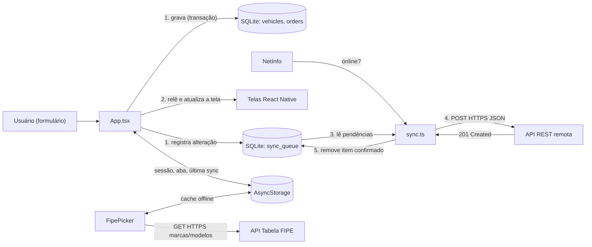
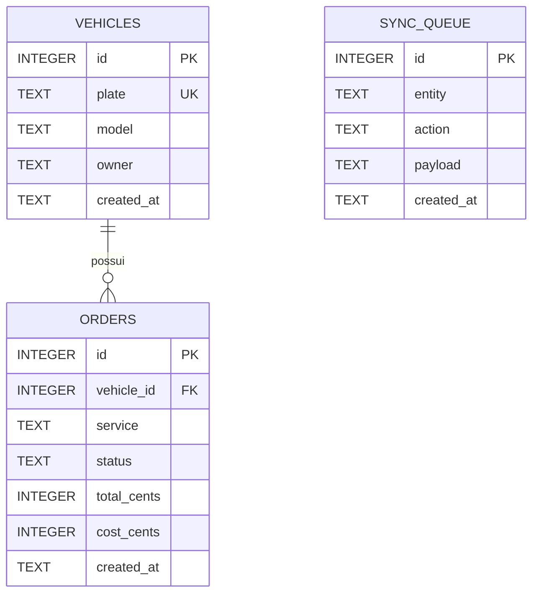

# Relatório de Extensão — Item 3: Planejamento e Desenvolvimento do Projeto

> Texto completo do **Item 3 (Planejamento e Desenvolvimento / Seção 2)** já incluído no arquivo Word oficial `Modelo_do_Relatrio_de_Extensao.docx`.

**Equipe Responsável (Sprint 3):**
- **Cauê** — Persistência Local Chave-Valor (`AsyncStorage`), Sessão e Autenticação (`src/storage/preferences.ts`, `src/screens/LoginScreen.tsx`)
- **Cauã** — Banco de Dados Relacional Embarcado (`SQLite`), DDL, CRUD e Transações (`src/storage/database.ts`, `src/storage/database.web.ts`)
- **Alexandre** — Consumo de APIs REST via HTTPS (`Tabela FIPE`), Cliente HTTP com Timeout e Feedback Visual (`src/api/client.ts`, `src/api/fipe.ts`, `src/FipePicker.tsx`)
- **Vinícius** — Arquitetura Offline-First, Monitoramento de Rede (`NetInfo`), Fila Outbox e Sincronização (`src/api/sync.ts`, `App.tsx`, `src/screens/HomeScreen.tsx`)

---

## 3.1 Visão geral da Sprint 3

Na Sprint 3 (outubro/2026), o TruckFlow evoluiu de um protótipo visual, cujos dados existiam apenas na memória volátil (`useState`) e eram perdidos ao fechar o aplicativo, para uma aplicação móvel **inteligente, resiliente e integrada a dados físicos e remotos**. O aplicativo passou a capturar informações em formulários (veículos e ordens de serviço), armazená-las de forma permanente na memória não volátil do celular e sincronizá-las com serviços remotos por meio de requisições **HTTPS REST**, seguindo a arquitetura **Offline-First**.

O público atendido — oficinas mecânicas de caminhões — frequentemente trabalha em galpões e pátios com sinal de internet instável. Por isso, a decisão de projeto foi garantir que **nenhuma operação dependa da internet para ser concluída**: o usuário cadastra, altera e consulta dados normalmente no aparelho, e a sincronização com o servidor remoto ocorre em segundo plano quando houver conexão.

---

## 3.2 Stack tecnológica adotada

| Camada | Tecnologia | Versão / Endereço | Finalidade no TruckFlow |
| --- | --- | --- | --- |
| Linguagem | TypeScript | `~6.0.3` | Tipagem estática dos dados (veículo, ordem, retorno FIPE e fila de sincronização). |
| Framework mobile | React Native | `0.86.3` | Interface nativa para Android e iOS a partir de um único código-fonte. |
| Plataforma | Expo SDK 57 / Expo Go | `~57.0.26` | Execução e homologação no dispositivo físico sem necessidade de compilação nativa manual. |
| Persistência chave-valor | AsyncStorage | `@react-native-async-storage/async-storage 2.2.0` | Sessão do usuário, última aba aberta, data da última sincronização e cache offline da Tabela FIPE. |
| Banco relacional embarcado | SQLite Nativo | `expo-sqlite ~57.0.4` | Tabelas relacionais `vehicles`, `orders` e `sync_queue`, com chaves estrangeiras e transações ACID. |
| Consumo de API REST (HTTPS) | Fetch API + AbortController | Nativo (ES2024 / TLS) | Cliente HTTP/HTTPS com cabeçalhos JSON, tratamento de erros (`ApiError`) e *timeout* de 10 segundos. |
| API pública HTTPS (GET) | API REST Tabela FIPE | `https://parallelum.com.br/fipe/api/v1/caminhoes` | Consulta em tempo real de montadoras e modelos oficiais de caminhões pesados no cadastro de veículos. |
| API remota HTTPS (POST) | JSONPlaceholder REST | `https://jsonplaceholder.typicode.com/posts` | Endpoint REST de recepção das alterações da fila *outbox* (`POST` com confirmação `201 Created`). |
| Monitoramento de rede | NetInfo | `@react-native-community/netinfo 12.0.1` | Detecta mudanças de estado online/offline em tempo real e dispara a sincronização automática. |
| Versionamento | Git + GitHub | `github.com/luilma-dev/Projeto-extensivo-desenvolvimento-mobile` | Controle de versão distribuído com histórico técnico de commits da equipe. |

### Por que AsyncStorage **e** SQLite juntos?

- **AsyncStorage (Chave-Valor):** ideal para valores leves, unitários e sem relacionamento, como a sessão ativa do operador (`@truckflow:session`), a última aba selecionada (`@truckflow:lastTab`), o horário da última sincronização (`@truckflow:lastSync`) e o cache rápido da lista de marcas (`@truckflow:fipeBrands`).
- **SQLite (Relacional):** ideal para dados estruturados do domínio que exigem integridade referencial e consultas relacionais. Cada ordem de serviço pertence a um veículo (`vehicle_id REFERENCES vehicles(id) ON DELETE CASCADE`), e cada escrita ocorre dentro de uma **transação atômica** (`withTransactionAsync`) junto com o registro na fila `sync_queue`.

---

## 3.3 Estrutura do projeto (módulos)

```text
App.tsx                     → Inicialização, estado global, monitoramento de rede (NetInfo) e ciclo de sync
src/
├── storage/                → MÓDULO DE PERSISTÊNCIA LOCAL (Cauê e Cauã)
│   ├── preferences.ts      → AsyncStorage: sessão, última aba, última sync e cache FIPE (Cauê)
│   ├── database.ts         → SQLite nativo: tabelas DDL, migração, CRUD transacional e fila outbox (Cauã)
│   └── database.web.ts     → Adaptador web com a mesma interface para homologação em navegador (Cauã)
├── api/                    → MÓDULO DE CONEXÃO REMOTA HTTPS (Alexandre e Vinícius)
│   ├── client.ts           → Cliente HTTPS base: Fetch API + AbortController (10s) + ApiError (Alexandre)
│   ├── fipe.ts             → Requisições GET HTTPS à Tabela FIPE com fallback para cache local (Alexandre)
│   └── sync.ts             → Requisições POST HTTPS para despacho sequencial da fila outbox (Vinícius)
├── screens/                → CAMADA DE APRESENTAÇÃO
│   ├── LoginScreen.tsx     → Autenticação administrativa integrada à sessão do AsyncStorage (Cauê)
│   ├── FleetScreen.tsx     → Gestão da frota integrada ao SQLite e ao seletor da Tabela FIPE (Cauã / Alexandre)
│   ├── OrdersScreen.tsx    → Abertura e avanço de ordens de serviço com cálculo em centavos (Cauã / Vinícius)
│   └── HomeScreen.tsx      → Painel financeiro e card de status da sincronização Online/Offline (Vinícius)
├── FipePicker.tsx          → Seletor de marcas/modelos FIPE com indicador visual ActivityIndicator (Alexandre)
├── components.tsx          → Componentes visuais compartilhados (Button, Field, Badge, FormModal)
├── data.ts                 → Tipagens TypeScript (Vehicle, Order, SyncItem) e dados iniciais (seed)
└── styles.ts               → Folha de estilos centralizada
```

---

## 3.4 Arquitetura de dados Offline-First, Persistência e Comunicação HTTPS

O princípio central do TruckFlow é: **o banco de dados local é a única fonte da verdade (*Single Source of Truth*)**. A interface nunca bloqueia esperando resposta da internet; ela lê e grava diretamente no SQLite local, enquanto o módulo remoto sincroniza via HTTPS em segundo plano.



### Fluxo sequencial de uma alteração e sincronização

```mermaid
sequenceDiagram
    participant U as Usuário
    participant App as App.tsx
    participant DB as SQLite
    participant Sync as sync.ts
    participant API as API REST (HTTPS)
    U->>App: Cadastra veículo
    App->>DB: BEGIN; INSERT vehicles; INSERT sync_queue; COMMIT
    App->>U: Veículo aparece na lista (imediato)
    alt Com internet
        App->>Sync: syncNow()
        Sync->>API: POST https://jsonplaceholder.typicode.com/posts
        API-->>Sync: 201 Created
        Sync->>DB: DELETE FROM sync_queue WHERE id = ?
    else Sem internet
        App->>U: Banner "Modo offline · 1 pendente"
        Note over App,Sync: Quando o NetInfo detectar a volta da conexão, a fila é enviada automaticamente
    end
```

### 3.4.1 Módulo 1 — Persistência Chave-Valor com AsyncStorage (Responsável: Cauê)

Implementado em `src/storage/preferences.ts` e integrado ao fluxo de autenticação (`src/screens/LoginScreen.tsx` e `App.tsx`), utiliza serialização JSON assíncrona (`AsyncStorage.getItem` / `AsyncStorage.setItem` / `AsyncStorage.removeItem`) com tratamento seguro de erros (`try/catch`).

| Chave no AsyncStorage | Tipo de Dado (JSON) | Finalidade Técnica no Aplicativo |
| --- | --- | --- |
| `@truckflow:session` | `{ email: string, loggedAt: string }` | Persiste a sessão administrativa após o login, mantendo o usuário autenticado ao fechar e reabrir o app. |
| `@truckflow:lastTab` | `'Início' \| 'Frota' \| 'Ordens'` | Armazena a última aba visitada para restaurar exatamente a tela em que o operador estava. |
| `@truckflow:lastSync` | `string` (Data ISO 8601) | Registra o carimbo de tempo da última sincronização concluída com o servidor remoto. |
| `@truckflow:fipeBrands` | `FipeItem[]` (`[{ codigo, nome }]`) | Guarda em cache local a lista de montadoras da Tabela FIPE para permitir abertura do seletor mesmo offline. |

### 3.4.2 Módulo 2 — Banco de Dados Relacional Embarcado com SQLite (Responsável: Cauã)

Implementado em `src/storage/database.ts` (e `src/storage/database.web.ts` para suporte ao navegador), gerencia o arquivo físico `truckflow.db` com `PRAGMA journal_mode = WAL` (maior desempenho de leitura/escrita concorrente) e `PRAGMA foreign_keys = ON` (garantia de integridade referencial). Todas as mutações executam dentro de `db.withTransactionAsync(...)`, assegurando atomicidade entre o registro principal e a fila `sync_queue`.



### 3.4.3 Módulo 3 — Consumo de APIs REST via HTTPS e Feedback Visual (Responsável: Alexandre)

Implementado em `src/api/client.ts`, `src/api/fipe.ts` e `src/FipePicker.tsx`, estabelece toda a camada de comunicação remota sob protocolo seguro **HTTPS (TLS)**:

1. **Cliente HTTP/HTTPS Centralizado (`src/api/client.ts`):**
   - Encapsula a `fetch` API nativa injetando automaticamente os cabeçalhos `Accept: application/json` e `Content-Type: application/json`.
   - Implementa controle estrito de *timeout* (padrão de **10.000 ms**) por meio da API nativa **`AbortController`**, abortando conexões presas em redes móveis instáveis.
   - Traduz falhas técnicas em mensagens claras por meio da classe **`ApiError`** (identificando códigos HTTP não-2xx, `AbortError` por tempo esgotado e queda de conexão).
2. **Integração com a API REST da Tabela FIPE (`src/api/fipe.ts`):**
   - Realiza requisições `GET` HTTPS para os endpoints públicos da Tabela FIPE de caminhões.
   - Sempre que a busca de marcas tem sucesso via HTTPS, atualiza o cache local no `AsyncStorage`; se o celular estiver sem internet, recupera transparentemente as marcas do cache e exibe aviso ao usuário.
3. **Componente Interativo com Indicador de Carregamento (`src/FipePicker.tsx`):**
   - Integrado ao modal de cadastro da tela `FleetScreen.tsx`, exibe o componente nativo **`ActivityIndicator`** (*spinner* giratório) acompanhado do texto *"Consultando a Tabela FIPE..."* durante toda a requisição HTTPS.

| Método | Endpoint HTTPS Completo | Cabeçalhos HTTP | Resposta de Sucesso | Uso no TruckFlow |
| --- | --- | --- | --- | --- |
| `GET` | `https://parallelum.com.br/fipe/api/v1/caminhoes/marcas` | `Accept: application/json` | `200 OK` — `[{ "codigo": "109", "nome": "MERCEDES-BENZ" }, ...]` | Lista todas as montadoras de caminhões no seletor do formulário de frota. |
| `GET` | `https://parallelum.com.br/fipe/api/v1/caminhoes/marcas/{codigo}/modelos` | `Accept: application/json` | `200 OK` — `{ "modelos": [{ "codigo": 3302, "nome": "..." }] }` | Lista os modelos reais da montadora escolhida e preenche o campo automaticamente. |
| `POST` | `https://jsonplaceholder.typicode.com/posts` | `Content-Type: application/json` | `201 Created` — `{ "id": 101, "entity": "...", "action": "..." }` | Recebe os pacotes JSON da fila local (`sync_queue`) durante a sincronização. |

### 3.4.4 Módulo 4 — Arquitetura Offline-First, NetInfo e Sincronização Outbox (Responsável: Vinícius)

Implementado em `src/api/sync.ts`, `App.tsx` e `src/screens/HomeScreen.tsx`, coordena a resiliência de rede da aplicação:

1. **Padrão Outbox (`sync_queue`):** Cada criação, atualização de status ou exclusão de veículo/ordem insere um evento estruturado (`entity`, `action`, `payload` JSON e `createdAt`) na tabela `sync_queue`.
2. **Monitoramento Reativo (`@react-native-community/netinfo`):** Um *listener* contínuo (`NetInfo.addEventListener`) acompanha `isConnected` e `isInternetReachable`. Quando o aparelho perde conexão, um banner de alerta (*"Modo offline · as alterações ficam salvas no aparelho"*) é exibido no topo.
3. **Despacho Sequencial Seguro (`syncPending`):** Quando a conexão retorna (ou quando o usuário aciona o botão *"Sincronizar agora"* na tela Início), cada item da fila é enviado via `POST` HTTPS. O registro só é removido da `sync_queue` (`database.removeFromQueue(id)`) após confirmação `201 Created` do servidor, garantindo **perda zero de dados**.

---

## 3.5 Evidências do protótipo

| Nº | Arquivo em `evidencias/` | Evidência Registrada | O que comprova |
| --- | --- | --- | --- |
| 1 | `evidencia_01_consulta_api_fipe.png` | Formulário de novo veículo preenchido via busca na Tabela FIPE (`SCANIA R-440 A 4x2`) | Consumo de API REST HTTPS (`GET`) com indicador visual de carregamento |
| 2 | `evidencia_02_veiculo_cadastrado_persistente.png` | Veículo recém-cadastrado listado na aba Frota junto aos demais registros | Gravação física e leitura no banco relacional SQLite (`vehicles`) |
| 3 | `evidencia_03_resumo_sincronizacao_online.png` | Card "Sincronização" na tela Início com badge `● Online`, 0 pendências e data/hora | Sincronização remota (`POST` HTTPS) e persistência do timestamp no AsyncStorage |
| 4 | `evidencia_04_persistencia_apos_reload.png` | Aplicativo fechado e reaberto mantendo login ativo, aba selecionada e veículos salvos | Comprovante de persistência não volátil (SQLite + AsyncStorage) após reinício |
| 5 | `evidencia_05_login_autenticado.png` | Tela de Login administrativo com aviso de retenção de sessão | Captura de credenciais e inicialização da sessão persistente |

---

## 3.6 Divisão de tarefas e desenvolvimento por integrante (Sprint 3)

| Integrante | Módulo de Responsabilidade | Arquivos Principais | Entregas Técnicas Realizadas |
| --- | --- | --- | --- |
| **Cauê** | Persistência Chave-Valor (`AsyncStorage`) e Autenticação | `src/storage/preferences.ts`, `src/screens/LoginScreen.tsx` | Implementação do gerenciador JSON no AsyncStorage; persistência e restauração da sessão de login (`@truckflow:session`), salvamento da última aba (`@truckflow:lastTab`), registro do horário de sync (`@truckflow:lastSync`) e cache local de marcas (`@truckflow:fipeBrands`). |
| **Cauã** | Banco de Dados Relacional Embarcado (`SQLite`) | `src/storage/database.ts`, `src/storage/database.web.ts`, `src/data.ts` | Modelagem relacional DDL (`vehicles`, `orders`, `sync_queue`); configuração de `WAL` e `foreign_keys`; implementação de CRUD assíncrono com transações atômicas (`withTransactionAsync`), exclusão em cascata e carga inicial (*seed*). |
| **Alexandre** | Consumo de APIs REST via HTTPS (`Tabela FIPE`) e Feedback Visual | `src/api/client.ts`, `src/api/fipe.ts`, `src/FipePicker.tsx`, `src/screens/FleetScreen.tsx` | Construção do cliente HTTPS com `AbortController` (*timeout* de 10s) e classe `ApiError`; consumo dos endpoints `GET https://parallelum.com.br/fipe/api/v1/caminhoes/...`; criação do seletor interativo com `ActivityIndicator` e *fallback* para cache offline. |
| **Vinícius** | Arquitetura Offline-First, `NetInfo` e Sincronização Outbox | `src/api/sync.ts`, `App.tsx`, `src/screens/HomeScreen.tsx`, `src/screens/OrdersScreen.tsx`, `docs/` | Implementação do envio sequencial da fila `sync_queue` via `POST https://jsonplaceholder.typicode.com/posts`; detecção automática de reconexão com `NetInfo`; banner de modo offline, card de sincronização com *spinner* na tela Início e consolidação do relatório. |

---

## 3.7 Próximos passos (Novembro)

- Refinamento de UI/UX com base em testes de usabilidade com operadores de oficina.
- Evolução do endpoint remoto para back-end dedicado da equipe, preservando integralmente o contrato da fila `sync_queue`.
- Realização do Simulado 2 e preparação do Pitch para a Banca Externa (24/11/2026).

---

## 3.8 Resumo Direto ao Ponto: O que cada integrante implementou e para que serve

### 1. Cauê — AsyncStorage (Persistência Chave-Valor e Sessão)
* **O que é:** Armazenamento interno simples do celular para salvar textos e configurações leves no formato chave-valor (`src/storage/preferences.ts` e `src/screens/LoginScreen.tsx`).
* **Para que serve no app:**
  * **Sessão (`@truckflow:session`):** Lembra o login do usuário para não pedir e-mail e senha toda vez que abrir o app.
  * **Navegação (`@truckflow:lastTab`):** Lembra a última aba aberta (Início, Frota ou Ordens) ao reabrir o app.
  * **Histórico de Sincronização (`@truckflow:lastSync`):** Guarda a data e hora exatas do último envio ao servidor.
  * **Cache Offline (`@truckflow:fipeBrands`):** Guarda a lista de montadoras da FIPE para consulta sem internet.

### 2. Cauã — SQLite / `expo-sqlite` (Banco de Dados Relacional Embarcado)
* **O que é:** Banco de dados relacional instalado fisicamente no celular com suporte a tabelas, chaves estrangeiras e transações ACID (`src/storage/database.ts`).
* **Para que serve no app:**
  * **Tabela `vehicles`:** Grava placa, modelo e cliente de forma permanente na memória do aparelho.
  * **Tabela `orders`:** Grava serviço, valores em centavos (`total_cents`, `cost_cents`), lucro e status.
  * **Integridade Referencial:** Amarra cada ordem ao seu caminhão (`vehicle_id`), apagando as ordens automaticamente se o veículo for excluído.
  * **Transações Atômicas (`withTransactionAsync`):** Garante que o dado salvo e o registro na fila de sincronização sejam gravados juntos sem risco de corromper o banco.

### 3. Alexandre — Consumo de APIs REST via HTTPS e Tabela FIPE
* **O que é:** Módulo de conexão HTTP/HTTPS (`src/api/client.ts`, `src/api/fipe.ts` e `src/FipePicker.tsx`) que busca dados externos em tempo real na internet usando `fetch` e `AbortController`.
* **Para que serve no app:**
  * **Requisições HTTPS (`GET`):** Consulta as montadoras em `https://parallelum.com.br/fipe/api/v1/caminhoes/marcas` e os modelos em `https://parallelum.com.br/fipe/api/v1/caminhoes/marcas/{codigo}/modelos`.
  * **Indicador Visual (`ActivityIndicator`):** Exibe um círculo giratório com o texto *"Consultando a Tabela FIPE..."* enquanto os dados são carregados da rede.
  * **Segurança de Rede (*Timeout* de 10s e `ApiError`):** Cancela automaticamente conexões lentas após 10 segundos para o app não travar e usa o cache local caso esteja sem internet.

### 4. Vinícius — Arquitetura Offline-First, NetInfo e Sincronização Outbox
* **O que é:** Estrutura que permite ao aplicativo funcionar 100% sem internet e sincronizar automaticamente quando a conexão retorna (`src/api/sync.ts`, `App.tsx` e `src/screens/HomeScreen.tsx`).
* **Para que serve no app:**
  * **Gravação Local Primeiro:** Toda ação do usuário é salva imediatamente no SQLite do celular e registrada na fila `sync_queue`.
  * **Monitoramento de Rede (`NetInfo`):** Vigia o sinal de Wi-Fi/4G em tempo real. Sem internet, mostra o aviso *"Modo offline"* com o número de pendências.
  * **Envio Remoto (`POST` HTTPS):** Quando há internet, envia cada item da fila para `https://jsonplaceholder.typicode.com/posts` e só remove da fila após o servidor responder `201 Created`.

### 5. Os 3 Diagramas Técnicos
* **Diagrama 1 (Arquitetura Geral):** Mostra a comunicação entre Telas, SQLite, AsyncStorage, NetInfo e APIs HTTPS.
* **Diagrama 2 (Fluxo Sequencial):** Mostra o passo a passo ao salvar um dado (grava no SQLite -> atualiza a tela -> verifica rede -> envia via POST HTTPS).
* **Diagrama 3 (Modelo ER):** Mostra a estrutura das 3 tabelas do SQLite (`vehicles`, `orders`, `sync_queue`) e seus relacionamentos.
